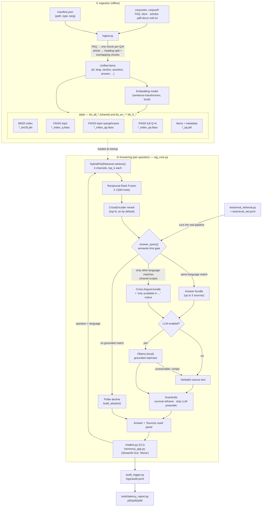

*A compassionate, clinically validated chatbot for adjuvant hormone therapy*

hormonAI is a **Retrieval-Augmented Generation (RAG) chatbot** that answers patient questions about **adjuvant hormone therapy for breast cancer** from a curated knowledge base (FAQ **and** reference articles), in **English and French**. In the chat interface the assistant is presented as **Mona**.

- Answers **only** from the knowledge base; politely declines everything else
- Shows **where every answer comes from**
- Runs **fully locally**: embeddings, reranker and the optional LLM all run on your machine
- Ships with a **CLI**, a **Streamlit GUI** and an **evaluation harness**

> hormonAI provides general information and is not medical advice. Patients should discuss their treatment with their care team.

---

## Contents

1. [How it works](#how-it-works)
2. [Quickstart](#quickstart)
3. [Knowledge base and ingestion](#knowledge-base-and-ingestion)
4. [Retrieval and scoring](#retrieval-and-scoring)
5. [Answering: abstain, language fallback, LLM](#answering-abstain-language-fallback-llm)
6. [Running the CLI and the GUI](#running-the-cli-and-the-gui)
7. [Models](#models)
8. [Configuration reference](#configuration-reference)
9. [Evaluation and quality checks](#evaluation-and-quality-checks)
10. [Logging, privacy and latency](#logging-privacy-and-latency)
11. [Repository structure](#repository-structure)

---

## How it works

The system has two phases: **ingestion** (offline, run once per corpus or model change) builds the indexes; **answering** (per question) retrieves candidates, decides whether the knowledge base really answers the question, and formats the reply.



| Module | Role |
|---|---|
| `ingest.py` | Type-aware ingestion: parses FAQ and article documents, chunks them, embeds them and writes the indexes. |
| `ingest_faq.py` | Legacy FAQ-only ingestion (writes `faq_{lang}_*`); can generate question paraphrases with Ollama. |
| `rag_core.py` | Retrieval (`HybridFAQRetriever`), answer/abstain decision (`answer_query`), LLM rephrasing (`LLMWrapperWriter`), guardrails. |
| `chatbot.py` | Interactive command-line chatbot. |
| `hormonai_app.py` | Streamlit GUI with language switching, LLM toggle, conversation history and a sources panel. |
| `audit_logger.py` | JSONL audit log of queries and decisions. |
| `tools/latency_report.py` | Latency percentiles from the audit log. |
| `tests/` | Gold eval set, evaluation harness, PDF extraction checks. |

---

## Quickstart

```bash
# 1. Environment
python3 -m venv hormonai_env
source hormonai_env/bin/activate
pip install -r requirements.txt

# 2. Choose models (must be the same for ingestion and querying)
export HORMONAI_EMBEDDING_MODEL="BAAI/bge-m3"
export HORMONAI_RERANK_MODEL="BAAI/bge-reranker-v2-m3"

# 3. Put the source documents under corpus/en and corpus/fr, list them in manifest.json,
#    then build the indexes
python ingest.py --manifest manifest.json --embedding-model "$HORMONAI_EMBEDDING_MODEL"

# 4. Chat
python chatbot.py -l en                 # CLI
streamlit run hormonai_app.py           # GUI
```

The source documents are available here: [HormonAI corpus](https://www.dropbox.com/scl/fo/wufdoiep8biwrrjygfska/AAnfOC0u-pUUPFAuDTzhncI?rlkey=u2fn41qvhf0vuo7az0vms6tnt&dl=0). The `corpus/` directory is not tracked in git.

Optional: for LLM rephrasing, install and start [Ollama](https://ollama.com/download) and run `ollama pull llama3.2` (see [LLM rephrasing](#optional-llm-rephrasing)).

---

## Knowledge base and ingestion

### Document types

`ingest.py` handles two document shapes and writes **one unified, language-tagged index**:

- **FAQ** (`.docx`): parsed into atomic Q/A pairs, one chunk per question.
- **Article** (`.docx`, `.md`, `.txt`, `.pdf`): split on the document's own headings where available (docx styles, markdown `#`), then into fixed-size overlapping child chunks (default 250 words, 40 overlap). Each chunk keeps a heading breadcrumb and a link to its parent section. PDFs have no reliable heading structure, so each PDF is chunked as one flowing document. PDF text is extracted with **PyMuPDF** (falling back to `pypdf`) and cleaned: running headers/footers removed, hyphenated line wraps rejoined, page-number lines dropped.

### Manifest

Sources are declared in a JSON manifest that tags each file's `type` and `lang`:

```json
[
  {"path": "corpus/en/FAQ_Hormono_EN.docx", "type": "faq",     "lang": "en"},
  {"path": "corpus/en/BCN-Tamoxifen.pdf",   "type": "article", "lang": "en"},
  {"path": "corpus/fr/FAQ_Hormono_FR.docx", "type": "faq",     "lang": "fr"},
  {"path": "corpus/fr/SCC-HT.pdf",          "type": "article", "lang": "fr"}
]
```

### Build the indexes

By default `ingest.py` builds **both** the combined multilingual index (`kb_all_*`) and the per-language indexes (`kb_en_*`, `kb_fr_*`):

```bash
python ingest.py --manifest manifest.json --embedding-model "BAAI/bge-m3"

# larger article chunks, shared index only
python ingest.py --manifest manifest.json --embedding-model "BAAI/bge-m3" \
  --chunk-size 300 --chunk-overlap 50 --no-per-language

# A/B a second model into a separate prefix (kb_bgem3_all_*, ...)
python ingest.py --manifest manifest.json --embedding-model "BAAI/bge-m3" --out-prefix kb_bgem3

# quick run without a manifest
python ingest.py --language en --faq corpus/en/FAQ_Hormono_EN.docx \
  --article corpus/en/BCN-Tamoxifen.pdf --embedding-model "BAAI/bge-m3"
```

For embedding models that need instruction prefixes (e.g. e5: `query:` / `passage:`), pass `--passage-prefix` and `--query-prefix`. The query prefix is stored with the index and applied automatically at query time.

Each index prefix produces five files:

```text
<prefix>_index_q.faiss    # FAISS on the topic side (FAQ question / article heading + lead text)
<prefix>_index_qp.faiss   # FAISS on topic + question paraphrases (same as topic if none)
<prefix>_index_qa.faiss   # FAISS on question/heading + full answer/body
<prefix>_qa.pkl           # Items + metadata (embedding model, query prefix)
<prefix>_bm25.pkl         # BM25 keyword index
```

### Legacy FAQ-only ingestion

`ingest_faq.py` is the original FAQ-only pipeline. It handles neither articles nor the shared index, and writes `faq_{lang}_*` files. It can generate question paraphrases with Ollama for the paraphrase index:

```bash
python ingest_faq.py -l en -d corpus/en/FAQ_Hormono_EN.docx
python ingest_faq.py -l en --augment-questions --paraphrase-n 6 -d corpus/en/FAQ_Hormono_EN.docx
```

---

## Retrieval and scoring

### Four retrieval channels

For every question, `HybridFAQRetriever.retrieve()` runs four channels and keeps the top `top_k` (default 40) candidates from each. FAQ pairs and article chunks share one schema, so every channel covers the whole knowledge base:

| Channel | Searches |
|---|---|
| **BM25** (keyword) | Tokenized full text: section/heading + question/title + answer/body |
| **FAISS topic** | FAQ question, or article heading + the chunk's leading text |
| **FAISS full** | FAQ question + answer, or article heading + full chunk body |
| **FAISS topic+paraphrases** | Topic plus question paraphrases when present |

The three dense channels use the same query vector, encoded once.

### Fusion and reranking

1. **Reciprocal Rank Fusion.** Each candidate's ranks are combined as `Σ 1 / (60 + rank)` across the four channels and stored as `fused_score`. This is an ordering score, not a similarity. The best cosine similarity across the dense channels is kept separately as `dense_sim`.
2. **CrossEncoder reranking** (on by default, disable with `--no-rerank`). The top-N fused candidates (`--rerank-top-n`) are scored as `(question, section + question + answer)` pairs; the result, `rerank_score`, replaces the fused ordering. The reranker loads lazily and the system degrades gracefully if it is unavailable.

---

## Answering: abstain, language fallback, LLM

### The answer/abstain gate

`answer_query()` decides **semantic-first** whether the knowledge base actually answers the question. It answers if either:

1. **Primary signal:** the top candidate's relevance clears its threshold: `rerank_score ≥ --rerank-threshold` when reranking is on, otherwise `dense_sim ≥ --sem-threshold`.
2. **Lexical safety net:** a candidate contains a rare, specific term from the question (an IDF-weighted *anchor* with above-average IDF) **and** is at least `--dense-floor` cosine-similar.

Additional rules:

- Anchors are derived from corpus statistics (IDF), so no hand-maintained stop-word lists are needed. They no longer gate answers on their own; they shape **multi-concept bundles** (up to 3 sources) and drive the safety net.
- Questions asking for **statistics** must be answered by a source that actually contains numbers for the asked concept.
- Otherwise the system **declines** with a language-specific message.

Thresholds are model-specific starting points and must be calibrated on the gold set (see [Evaluation](#evaluation-and-quality-checks)). For a patient-facing tool, the hard constraint is a **zero false-answer rate** on out-of-scope questions. Design details: [`RETRIEVAL_REVIEW.md`](RETRIEVAL_REVIEW.md).

### Language scope

| Scope | Index | Behavior |
|---|---|---|
| `shared` | `kb_all_*` | Same-language sources first; if none qualify, sources in the other language are shown **verbatim** with an "only available in <language>" notice. Content is never machine-translated. |
| `language` | `kb_<lang>_*` | Only the question's language is searched; no cross-lingual fallback. |

Set it with `--retrieval-scope` or `HORMONAI_RETRIEVAL_SCOPE`. It is an operator setting with no patient-facing control. Defaults differ by interface: the **GUI** defaults to `shared` (falling back to the per-language index if `kb_all_*` is missing); the **CLI** defaults to the per-language index unless `--retrieval-scope shared` or the legacy `--shared` flag is given.

### Optional LLM rephrasing

By default the retrieved text is quoted verbatim with a short fixed empathy line. With `--use-llm` (CLI) or the "LLM rephrasing" toggle (GUI), a local **Ollama** model rewrites **only the retrieved source text** for clarity and warmth. The prompt forbids adding facts, figures, drugs or dosages, requires keeping every caveat, and keeps the source's degree of certainty.

If Ollama is unreachable or returns nothing, the answer falls back to verbatim text, and the fallback is reported: the CLI prints a `[notice]` to stderr naming the reason, the GUI shows a short warning.

Setup:

```bash
ollama serve                                  # API on http://localhost:11434
ollama pull llama3.2                          # default model (3B)
curl http://localhost:11434/api/version       # optional check
```

Override the endpoint with `OLLAMA_HOST` and the model with `--llm-model` / `HORMONAI_LLM_MODEL`. Start Ollama before launching the CLI or GUI.

### Guardrails on every answer

- **Survival framing:** patient-mortality phrasing is reframed as survival language (e.g. "reduce the risk of dying from breast cancer" → "improve long-term survival") without changing meaning. Accurate statements about cancer cells dying are left untouched.
- **Preamble stripping:** leading LLM meta-text such as "Here is a clear and compassionate response…" is removed.
- **Sources out of the body:** sources are shown in the GUI's "Sources used for this answer" panel or printed after the answer in the CLI.

---

## Running the CLI and the GUI

### CLI

```bash
python chatbot.py -l en --debug                              # per-language index, retrieval details
python chatbot.py -l fr --retrieval-scope shared             # shared index with cross-lingual fallback
python chatbot.py -l en --use-llm \
  --rerank-model BAAI/bge-reranker-v2-m3 --rerank-threshold 0.2 --rerank-top-n 5
```

`--debug` prints candidates, scores, the decision path and a latency breakdown.

### GUI

```bash
streamlit run hormonai_app.py
streamlit run hormonai_app.py -- --retrieval-scope language  # query-language corpus only
```

The GUI accepts **the same launch arguments as the CLI**, passed after Streamlit's `--` separator:

```bash
streamlit run hormonai_app.py -- \
  --rerank-top-n 5 --rerank-model BAAI/bge-reranker-v2-m3 --rerank-threshold 0.2 --debug
```

Precedence is **flag > environment variable > built-in default**. Retrieval and model flags apply at launch; `--language`, `--use-llm` and `--rerank/--no-rerank` only seed the sidebar defaults, which can be changed live. Model choices and `--top-k` are launch-time only, because the index is cached and the embedding model must match ingestion.

---

## Models

| Purpose | Default | Recommended |
|---|---|---|
| Embeddings | `sentence-transformers/paraphrase-multilingual-mpnet-base-v2` | `BAAI/bge-m3` |
| Reranker | `cross-encoder/mmarco-mMiniLMv2-L12-H384-v1` | `BAAI/bge-reranker-v2-m3` |
| LLM (optional) | `llama3.2` via Ollama | |

BGE-M3 and bge-reranker-v2-m3 are both multilingual and Apache-2.0 licensed, and rank lay and clinical questions noticeably better than the defaults. Each is roughly 2.3 GB and much faster on a GPU.

- **The indexes committed in `data/` were built with `BAAI/bge-m3`**, so set `HORMONAI_EMBEDDING_MODEL=BAAI/bge-m3` to use them as-is.
- **The embedding model must be identical at ingestion and query time.** The loader checks the output dimension against the FAISS index and refuses a mismatch. Changing it requires a fresh ingest.
- **Changing either model changes the score scale**, so re-calibrate the thresholds afterwards.

### Local and offline use

Embeddings and reranking run **in-process** via `sentence-transformers`/PyTorch; there is no external inference API. Models are downloaded once from the Hugging Face Hub and cached (`~/.cache/huggingface`). The model settings also accept a local directory:

```bash
export HORMONAI_EMBEDDING_MODEL="/models/bge-m3"
export HORMONAI_RERANK_MODEL="/models/bge-reranker-v2-m3"
export HF_HUB_OFFLINE=1          # never contact the Hub
export TRANSFORMERS_OFFLINE=1
```

---

## Configuration reference

The CLI, GUI and eval harness read the same environment variables, so a calibrated configuration applies everywhere.

| Variable | Default | Purpose |
|---|---|---|
| `HORMONAI_EMBEDDING_MODEL` | `sentence-transformers/paraphrase-multilingual-mpnet-base-v2` | Embedding model (Hub id or local path). Must match ingestion. |
| `HORMONAI_RERANK_MODEL` | `cross-encoder/mmarco-mMiniLMv2-L12-H384-v1` | Reranker (Hub id or local path). |
| `HORMONAI_RERANK_TOP_N` | `5` in CLI, `20` in eval harness | Rerank only the top-N fused candidates. Lower is faster. |
| `HORMONAI_RETRIEVAL_SCOPE` | GUI `shared`, CLI unset (per-language) | `shared` or `language`; see [Language scope](#language-scope). |
| `HORMONAI_RERANK_THRESHOLD` | `-1.0` | Accept threshold on the reranker score. Model-specific. |
| `HORMONAI_SEM_THRESHOLD` | `0.62` | Dense-cosine accept threshold (reranking off). |
| `HORMONAI_DENSE_FLOOR` | `0.50` | Cosine floor for the lexical safety net. |
| `HORMONAI_LLM_MODEL` | `llama3.2` | Ollama model for rephrasing. |
| `OLLAMA_HOST` | `http://localhost:11434` | Ollama endpoint. |
| `HORMONAI_SHOW_TIMING` | `0` | `1` shows a per-query latency breakdown in the GUI (also on with `--debug`). |
| `HORMONAI_AUDIT_LATENCY` | `0` | `1` makes the GUI log a latency record per query (no query text). |
| `HORMONAI_AUDIT_LOG` | `logs/audit.jsonl` | Log file read by `tools/latency_report.py`. |

---

## Evaluation and quality checks

### Retrieval and gating

`tests/eval_set.jsonl` is a gold set (EN + FR, categorized) keyed by item IDs of the form `<source_id>:<n>`, where `source_id` is the source file name without extension. If a source file is renamed, update the gold IDs to match. Each case states whether it should be answered and which sources are correct.

`tests/eval_retrieval.py` runs it through the real pipeline and reports decision accuracy, recall@k, lead-source correctness, gold-source-in-bundle, and the false-abstention and false-answer rates:

```bash
python tests/eval_retrieval.py --shared --verbose                 # production (shared) path
python tests/eval_retrieval.py --shared --rerank-threshold 0      # threshold sweep
python tests/eval_retrieval.py --lang fr --json results.json      # one language, full results
```

Re-run it after any change to models, thresholds, ingestion or `rag_core.py`.

### PDF extraction fidelity

PDF extraction is the weakest link, and for a medical tool a garbled number or a dropped "not" is a safety issue. Check it before ingesting:

```bash
python tests/pdf_fidelity.py --manifest manifest.json
python tests/pdf_fidelity.py --preview --only NCI-HT.pdf
```

It reports per-source extraction health and exits non-zero if a PDF looks scanned or empty (no text layer).

> PyMuPDF is AGPL-licensed. That is fine for internal and research use; review licensing before redistributing a product built on it. `pypdf` (BSD) is the automatic fallback.

---

## Logging, privacy and latency

- The **CLI** appends one event per question to `logs/audit.jsonl` (`--audit-log`): the query, language, whether it was answered, whether the LLM was used, the lead source and timings.
- The **GUI** logs only when `HORMONAI_AUDIT_LATENCY=1`, and then only timings, language and the answered flag, never the query text.
- Audit logs can contain patient questions: keep them out of git (`logs/` is in `.gitignore`) and do not record personally identifiable information.

The reranker dominates per-query latency. `--rerank-top-n` is the main lever; a smaller reranker or a GPU also help. Aggregate logged timings into percentiles:

```bash
python tools/latency_report.py
python tools/latency_report.py --answered-only --lang en
```

---

## Repository structure

```text
.
├── ingest.py              # Type-aware ingestion (FAQ + articles, shared + per-language indexes)
├── ingest_faq.py          # Legacy FAQ-only ingestion
├── rag_core.py            # Retriever, answer/abstain gate, cross-lingual fallback, LLM rephrasing
├── chatbot.py             # Command-line chatbot
├── hormonai_app.py        # Streamlit GUI ("Mona")
├── audit_logger.py        # JSONL audit logger
├── manifest.json          # Ingestion manifest (path, type, lang)
├── RETRIEVAL_REVIEW.md    # Retrieval design notes and change log
├── AGENTS.md              # Guidance for AI coding assistants
├── data/                  # Generated indexes: kb_all_* and kb_{en,fr}_*
├── corpus/                # Source documents by language (not tracked)
├── logs/                  # Audit logs (must not be committed)
├── tests/
│   ├── eval_set.jsonl     # Gold evaluation cases (EN + FR)
│   ├── eval_retrieval.py  # Evaluation harness
│   ├── pdf_fidelity.py    # PDF extraction checks
│   ├── inspect_qa.py      # Legacy: inspect faq_* items
│   └── test_retreival.py  # Legacy: retrieval smoke test on faq_* indexes
└── tools/
    └── latency_report.py  # p50/p95/p99 latency from the audit log
```

## License

MIT, see [LICENSE](LICENSE).
